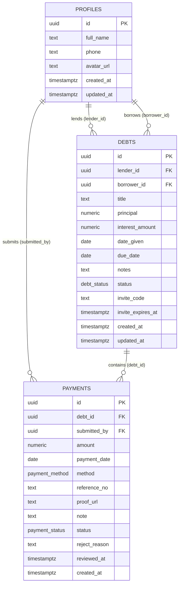

# DebtCollect — Database Architecture & Schema Specification

**Target Database:** PostgreSQL 17 on Supabase (`Debt Collect` - `nvjtathtqfzftxmofuid`)  
**Design Principles:**
1. **Per-Debt Roles:** Single user table. Whether a user is a Lender or Borrower is determined by their foreign key in each `debts` record.
2. **Strict RLS (Row Level Security):** Users can only ever access debts and payments they are directly a party to.
3. **Atomic State Transitions via RPCs:** Sensitive actions (joining debts, confirming/rejecting payments) are handled via stored functions (`SECURITY DEFINER`) to guarantee ACID compliance and avoid race conditions.
4. **Calculated Balances via View:** Balance calculations are centralized in a database view to eliminate sync errors between payments and debts.

---

## 1. Entity-Relationship Overview



---

## 2. Enums and Data Types

```sql
-- Status of a debt loan lifecycle
CREATE TYPE public.debt_status AS ENUM (
    'awaiting_borrower', -- Lender created debt, invite code active, no borrower yet
    'active',            -- Borrower accepted, debt ongoing
    'paid',              -- Fully settled (confirmed payments >= principal + interest)
    'cancelled'          -- Lender cancelled the debt before completion
);

-- Supported modes of payment in the Philippines
CREATE TYPE public.payment_method AS ENUM (
    'cash',
    'gcash',
    'maya',
    'bank_transfer',
    'other'
);

-- Payment confirmation state
CREATE TYPE public.payment_status AS ENUM (
    'pending',   -- Submitted by borrower, waiting for lender confirmation
    'confirmed', -- Approved by lender (or auto-approved if recorded by lender)
    'rejected'   -- Declined by lender with reason
);
```

---

## 3. Table Definitions & Constraints

### 3.1 `profiles`
Automatically populated upon user signup via `auth.users` trigger.

```sql
CREATE TABLE public.profiles (
    id UUID PRIMARY KEY REFERENCES auth.users(id) ON DELETE CASCADE,
    full_name TEXT NOT NULL CHECK (char_length(trim(full_name)) >= 2),
    phone TEXT NULL,
    avatar_url TEXT NULL,
    created_at TIMESTAMPTZ NOT NULL DEFAULT timezone('utc'::text, now()),
    updated_at TIMESTAMPTZ NOT NULL DEFAULT timezone('utc'::text, now())
);
```

### 3.2 `debts`
Stores the core loan terms.

```sql
CREATE TABLE public.debts (
    id UUID PRIMARY KEY DEFAULT gen_random_uuid(),
    lender_id UUID NOT NULL REFERENCES public.profiles(id) ON DELETE CASCADE,
    borrower_id UUID NULL REFERENCES public.profiles(id) ON DELETE SET NULL,
    title TEXT NOT NULL CHECK (char_length(trim(title)) >= 2),
    principal NUMERIC(12, 2) NOT NULL CHECK (principal > 0),
    interest_amount NUMERIC(12, 2) NOT NULL DEFAULT 0.00 CHECK (interest_amount >= 0),
    date_given DATE NOT NULL DEFAULT CURRENT_DATE,
    due_date DATE NULL,
    notes TEXT NULL,
    status public.debt_status NOT NULL DEFAULT 'awaiting_borrower',
    invite_code TEXT UNIQUE NULL,
    invite_expires_at TIMESTAMPTZ NULL,
    created_at TIMESTAMPTZ NOT NULL DEFAULT timezone('utc'::text, now()),
    updated_at TIMESTAMPTZ NOT NULL DEFAULT timezone('utc'::text, now()),

    -- Business Rules Constraints
    CONSTRAINT chk_lender_not_borrower CHECK (lender_id <> borrower_id),
    CONSTRAINT chk_due_date_after_given CHECK (due_date IS NULL OR due_date >= date_given)
);

CREATE INDEX idx_debts_lender ON public.debts(lender_id);
CREATE INDEX idx_debts_borrower ON public.debts(borrower_id);
CREATE INDEX idx_debts_invite_code ON public.debts(invite_code) WHERE invite_code IS NOT NULL;
```

### 3.3 `payments`
Tracks individual repayment transactions and verification flow.

```sql
CREATE TABLE public.payments (
    id UUID PRIMARY KEY DEFAULT gen_random_uuid(),
    debt_id UUID NOT NULL REFERENCES public.debts(id) ON DELETE CASCADE,
    submitted_by UUID NOT NULL REFERENCES public.profiles(id) ON DELETE CASCADE,
    amount NUMERIC(12, 2) NOT NULL CHECK (amount > 0),
    payment_date DATE NOT NULL DEFAULT CURRENT_DATE,
    method public.payment_method NOT NULL,
    reference_no TEXT NULL,
    proof_url TEXT NULL,
    note TEXT NULL,
    status public.payment_status NOT NULL DEFAULT 'pending',
    reject_reason TEXT NULL,
    reviewed_at TIMESTAMPTZ NULL,
    created_at TIMESTAMPTZ NOT NULL DEFAULT timezone('utc'::text, now()),

    -- Reference number required if not paying by cash
    CONSTRAINT chk_reference_no_required CHECK (
        method = 'cash' OR (reference_no IS NOT NULL AND char_length(trim(reference_no)) > 0)
    )
);

CREATE INDEX idx_payments_debt_id ON public.payments(debt_id);
CREATE INDEX idx_payments_status ON public.payments(status);
```

---

## 4. Calculated Views (`debt_summary`)

To avoid balance mismatch issues, balances are calculated live on confirmed payments.

```sql
CREATE OR REPLACE VIEW public.debt_summary
WITH (security_invoker = true) AS
SELECT 
    d.id,
    d.lender_id,
    d.borrower_id,
    d.title,
    d.principal,
    d.interest_amount,
    (d.principal + d.interest_amount) AS total_amount,
    COALESCE(SUM(p.amount) FILTER (WHERE p.status = 'confirmed'), 0.00) AS total_paid,
    ((d.principal + d.interest_amount) - COALESCE(SUM(p.amount) FILTER (WHERE p.status = 'confirmed'), 0.00)) AS remaining_balance,
    COUNT(p.id) FILTER (WHERE p.status = 'pending') AS pending_payments_count,
    d.date_given,
    d.due_date,
    d.status,
    d.invite_code,
    d.invite_expires_at,
    CASE 
        WHEN d.due_date IS NOT NULL AND d.due_date < CURRENT_DATE AND d.status = 'active'
        THEN true 
        ELSE false 
    END AS is_overdue,
    d.created_at,
    d.updated_at
FROM public.debts d
LEFT JOIN public.payments p ON d.id = p.debt_id
GROUP BY d.id;
```

---

## 5. Row Level Security (RLS) Policies

All tables have RLS enabled:
- **`profiles`:**
  - Users can read their own profile, or any profile of someone they have an active debt with.
  - Users can only update their own profile.
- **`debts`:**
  - Users can view debts where `auth.uid() = lender_id` OR `auth.uid() = borrower_id`.
  - Only authenticated lenders can insert debts (`lender_id = auth.uid()`).
  - Only the lender can update debt terms (cannot change `borrower_id` directly, that requires `join_debt` RPC).
- **`payments`:**
  - Users can view payments for debts they are a party to.
  - Borrowers can insert payments with `status = 'pending'`.
  - Lenders can insert payments with `status = 'confirmed'` (direct receipt).
  - Updating status (reviewing) is only permitted via the `review_payment` RPC.

---

## 6. Stored Procedures / RPC Functions

1. **`generate_invite_code(p_debt_id UUID)`**
   - Lender only.
   - Generates a cryptographically randomized 6-character code (`DC-XXXXXX`).
   - Sets 7-day expiration.

2. **`preview_debt_by_code(p_code TEXT)`**
   - Anyone authenticated.
   - Returns Lender's Name, Debt Title, Total Amount, Due Date.
   - Allows borrower to inspect the loan terms before joining without exposing sensitive data.

3. **`join_debt(p_code TEXT)`**
   - Validates that code exists, is unexpired, and caller is not the lender.
   - Atomically assigns `borrower_id = auth.uid()`, changes `status = 'active'`, and invalidates the invite code.

4. **`review_payment(p_payment_id UUID, p_approve BOOLEAN, p_reject_reason TEXT)`**
   - Validates caller is the debt's lender.
   - Updates status to `'confirmed'` or `'rejected'`.
   - If confirmed, checks if remaining balance hits 0 and automatically transitions debt to `'paid'`.
