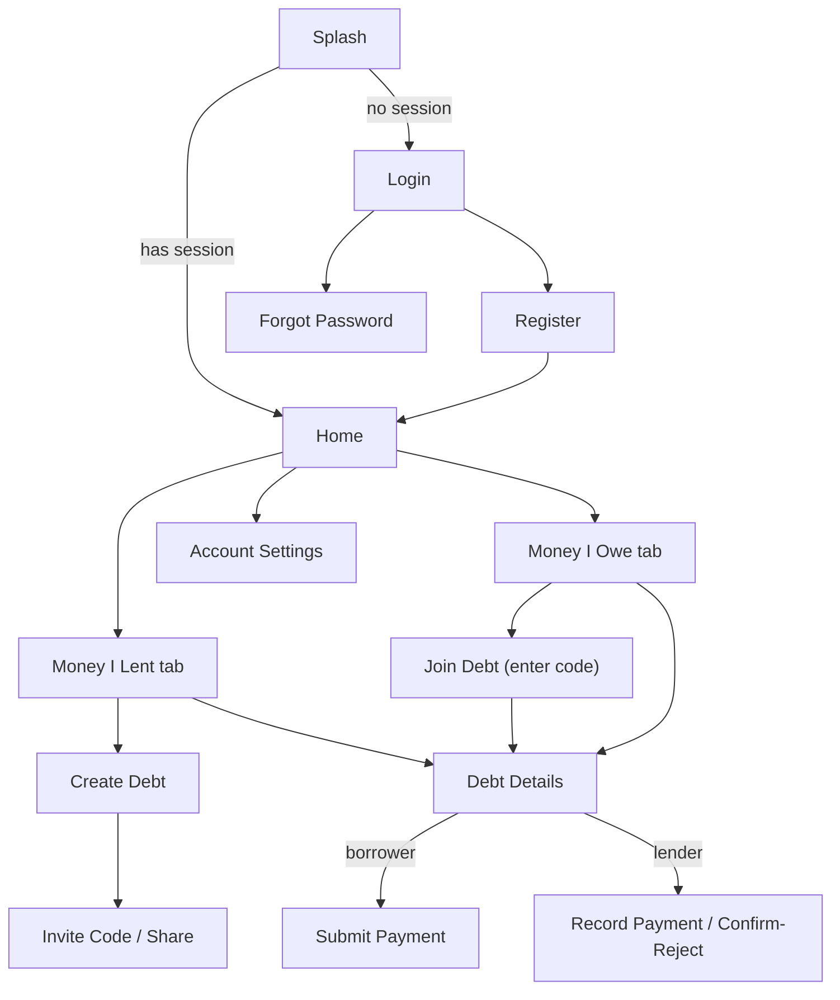
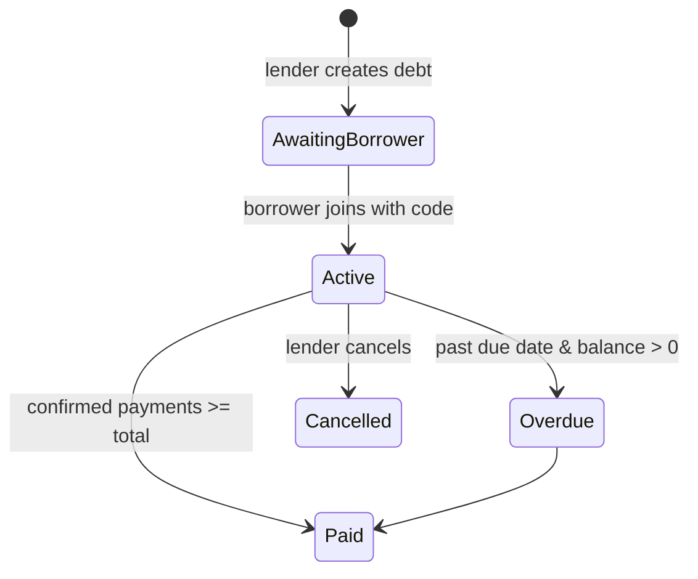

# DebtCollect — Implementation Plan

An Android app (Jetpack Compose + Supabase) for recording debts and payments between a **lender** and a **borrower**.

## 1. Key Decisions

| Topic | Decision |
|---|---|
| Backend | Supabase (Auth, Postgres + RLS, Storage later) |
| UI | Jetpack Compose + Material 3 |
| Roles | One account type. Role is decided **per debt**: whoever creates it is the lender, whoever joins it is the borrower |
| Linking | **Invite code** (e.g. `DC-7K4P9Q`), one-time use, expires in 7 days |
| Payments | Borrower submits payment (method + reference no.) → lender **confirms / rejects**. Lender can also record payments directly (auto-confirmed) |
| Currency | PHP (₱) |

> [!IMPORTANT]
> The current project is an **XML/Views template** (`activity_main.xml`, AppCompat). Phase 0 converts it to Compose. The `.example` package name should also be changed (e.g. `com.trick.debtcollect`) before publishing.

---

## 2. User Flow



## 3. Debt and Payment Status



Payment: `pending` → `confirmed` | `rejected` (with reason). Only **confirmed** payments reduce the balance.

---

## 4. Supabase Database

### Tables

**`profiles`** (1:1 with `auth.users`, auto-created by a trigger on sign-up)
| column | type |
|---|---|
| id | uuid PK → auth.users |
| full_name | text |
| phone | text null |
| avatar_url | text null |
| created_at | timestamptz |

**`debts`**
| column | type | notes |
|---|---|---|
| id | uuid PK | |
| lender_id | uuid → profiles | creator |
| borrower_id | uuid null → profiles | set when joined |
| title | text | e.g. "Motorcycle loan" |
| principal | numeric(12,2) | > 0 |
| interest_amount | numeric(12,2) | default 0 (flat) |
| date_given | date | |
| due_date | date null | |
| notes | text null | |
| status | enum `awaiting_borrower, active, paid, cancelled` | overdue is computed |
| invite_code | text unique null | cleared after join |
| invite_expires_at | timestamptz null | |
| created_at / updated_at | timestamptz | |

**`payments`**
| column | type | notes |
|---|---|---|
| id | uuid PK | |
| debt_id | uuid → debts | |
| submitted_by | uuid → profiles | |
| amount | numeric(12,2) | > 0 |
| payment_date | date | |
| method | enum `cash, gcash, maya, bank_transfer, other` | |
| reference_no | text null | **required unless cash** (CHECK constraint) |
| proof_url | text null | Phase 6 |
| note | text null | |
| status | enum `pending, confirmed, rejected` | |
| reject_reason | text null | |
| reviewed_at | timestamptz null | |
| created_at | timestamptz | |

**View `debt_summary`**: debt + `total_due`, `total_paid` (confirmed only), `balance`, `is_overdue`, pending count. Created with `security_invoker = true` so RLS still applies.

### Security (RLS)
- `profiles`: users read their own profile plus profiles of people they share a debt with. Users update only their own.
- `debts`: select if `auth.uid()` is the lender or borrower. Insert only when `lender_id = auth.uid()`. Update only by the lender. Borrowers **cannot** set `borrower_id` directly; they go through the RPC.
- `payments`: select if party to the debt. A borrower can insert with `status = 'pending'`. A lender can insert with `status = 'confirmed'`. Status changes go through RPCs only.

### RPC functions (`security definer`, validated inside)
| function | purpose |
|---|---|
| `generate_invite_code(debt_id)` | lender only; creates a new code with a 7-day expiry |
| `preview_debt_by_code(code)` | returns lender name + amount so the borrower can review before accepting |
| `join_debt(code)` | checks the code is valid, unexpired and unused, and that the caller isn't the lender; sets borrower, status → active, clears the code |
| `review_payment(payment_id, approve, reason)` | lender only; confirms or rejects; marks the debt `paid` when the balance reaches 0 |

All changes are applied as **Supabase migrations**, and the security advisor is run after each one.

---

## 5. Android Architecture

**Stack:** Kotlin · Compose Material 3 · Navigation Compose · MVVM (ViewModel + StateFlow) · Hilt · supabase-kt (`auth-kt`, `postgrest-kt`, `functions`) · Ktor client · kotlinx.serialization · kotlinx-datetime

```
com.example.debtcollect/
├── DebtCollectApp.kt          // @HiltAndroidApp
├── MainActivity.kt            // setContent { AppNavHost() }
├── di/                        // SupabaseModule, RepositoryModule
├── data/
│   ├── model/                 // Profile, Debt, DebtSummary, Payment (@Serializable)
│   └── repository/            // AuthRepository, ProfileRepository, DebtRepository, PaymentRepository
├── ui/
│   ├── theme/
│   ├── components/            // MoneyText, StatusChip, LoadingButton, EmptyState
│   ├── navigation/            // Routes, AppNavHost
│   ├── auth/                  // Login, Register, ForgotPassword (+ ViewModels)
│   ├── home/                  // HomeScreen with Lent / Owe tabs, summary cards
│   ├── debt/                  // CreateDebt, InviteCode, JoinDebt, DebtDetails
│   ├── payment/               // SubmitPayment, RecordPayment, ReviewPaymentSheet
│   └── settings/              // AccountSettings, EditProfile, ChangePassword
└── util/                      // formatters, validators
```

The Supabase URL and publishable key go in `local.properties` and are exposed through `BuildConfig`, so they are not committed to git.

## 6. Screens

| # | Screen | Key content |
|---|---|---|
| 1 | Splash | checks session → Login or Home |
| 2 | Login | email, password, "Forgot password?", "Register" |
| 3 | Register | full name, email, phone (opt.), password, confirm |
| 4 | Forgot Password | email → Supabase reset email |
| 5 | Home – Lent tab | cards: Total lent · Collected · Outstanding · Overdue; pending-confirmation banner; debt list |
| 6 | Home – Owe tab | cards: Total owed · Next due date; debt list; **Join Debt** button |
| 7 | Create Debt | title, amount, interest, date given, due date, notes |
| 8 | Invite Code | big code, copy, share (Android share sheet), expiry, regenerate |
| 9 | Join Debt | enter code → preview (lender, amount, due) → Accept |
| 10 | Debt Details | amounts, progress bar, status, other party, payment timeline; role-specific actions |
| 11 | Submit Payment (borrower) | amount, date, method dropdown, reference no. (required unless Cash), note |
| 12 | Record Payment (lender) | same form, auto-confirmed |
| 13 | Review Payment (sheet) | details + Confirm / Reject (with reason) |
| 14 | Account Settings | profile info, edit profile, change password, logout |

---

## 7. Build Phases

| Phase | Scope | Done when |
|---|---|---|
| **0. Setup** | Convert to Compose, add dependencies, Hilt, theme, navigation skeleton; create/choose Supabase project | App launches into an empty Compose NavHost |
| **1. Database** | Migrations: enums, tables, trigger, view, RLS, RPCs; run advisors | Advisors clean; SQL tests of RLS pass |
| **2. Auth** | Splash, Login, Register, Forgot Password, session persistence | Can register, log out, log back in |
| **3. Debts (lender)** | Create Debt, Invite Code + share, Lent tab list | Lender creates a debt and shares the code |
| **4. Join (borrower)** | Join Debt + preview, Owe tab | Second account joins → debt Active for both |
| **5. Payments** | Submit, Record, Review, Debt Details timeline, balance | End-to-end: submit → confirm → balance drops → Paid |
| **6. Dashboards & Settings** | Summary cards, Account Settings, edit profile, change password | Totals correct for both tabs |
| **7. Later** | Proof screenshot upload (Storage), due-date reminders (WorkManager / push), PDF statement, offline borrower (option C), realtime updates | — |

## 8. Verification
- **DB:** SQL checks as two different users. For example, the borrower cannot confirm a payment, a stranger cannot read a debt, and an expired code fails.
- **App:** unit tests for validators and ViewModels; manual end-to-end with two accounts on emulator + device.
- **Build:** `gradlew assembleDebug` passes after every phase.

## 9. Open Questions
1. **Supabase project:** use an existing project in your org, or create a new one (free tier)?
2. **Interest:** flat amount only for now? (Percentage or monthly interest adds complexity.)
3. **Email confirmation** on sign-up: keep it on (more secure), or turn it off during development?
4. **Package name:** keep `com.example.debtcollect` or rename now?
